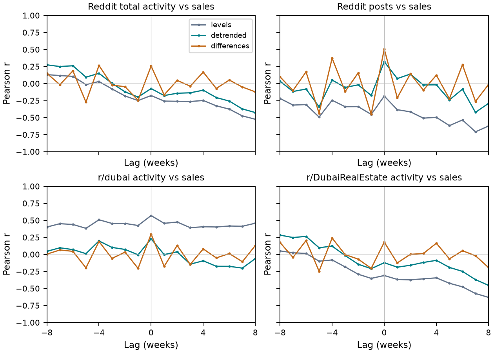

# Reddit Activity and Dubai Real Estate Registrations

### An Exploratory Weekly Association Study

**Muath Alrammal · Milan Dordevic · Nourchène Elleuch Ben Ayed · Aaron Saji Abraham · Prajwal Kokatnur · Keletso J. Letsholo**

[Study](#the-study) · [Reproduce](#reproduce-the-analysis) · [Notebooks](#notebooks) · [Data](docs/data.md) · [Methods](docs/methods.md) · [Citation](#citation)

## The study

Do relationships between online housing discussion and property-market activity persist when we account for time trends and examine week-to-week changes?

This study compares **175,090 retained Reddit submissions and comments** from r/dubai and r/DubaiRealEstate with **270,558 Dubai Land Department registrations** across **58 observed weekly bins**, labelled 28 July 2025 to 31 August 2026. We examine activity counts against sales, mortgages and gifts, with additional analyses of off-plan and ready/existing sales.

The analysis combines contemporaneous correlations, adjustment for calendar time, weekly changes, complete lag profiles and a paired stationary bootstrap. Its purpose is to assess how stable the associations are under different analytical choices.

### Main findings

- **Time trends matter.** The r/dubai–sales correlation falls from **0.572** in levels to **0.231** after linear time adjustment.
- **Some same-week change associations persist.** Submissions and sales have a weekly-change correlation of **0.508**. Submissions and r/dubai have positive pointwise bootstrap intervals across the tested block lengths; pooled activity and r/DubaiRealEstate intervals include zero.
- **There is no robust single lead–lag delay.** Lag profiles change across levels, detrended series, weekly changes and temporal support.



*Positive lag means Reddit precedes DLD. The figure shows the complete −8 to +8 week window, rather than selecting one maximum.*

These are exploratory associations. They do not establish social-media impact, speculative purchasing, causal effects or validated forecasting signals.

## Reproduce the analysis

The public analysis runs from included weekly aggregates. No Reddit account, private text, GPU or DeBERTa download is needed. Use **Python 3.12**.

```sh
git clone https://github.com/aaronab810/dld_reddit.git
cd dld_reddit
python -m venv .venv
```

Activate with `.\.venv\Scripts\Activate.ps1` on Windows PowerShell, or `source .venv/bin/activate` on macOS/Linux. Then:

```sh
python -m pip install -r requirements.txt
python scripts/reproduce.py
```

The command regenerates tables and figures in `outputs/` and verifies **all 21 reference tables**, including bootstrap results and the historical aggregate comparison. It finishes with `Reproduction complete: 21 reference tables verified.` followed by the output path. Generated outputs stay out of Git.

Run the tests with:

```sh
python -m unittest discover -s tests
```

## Notebooks

| Notebook | Role | Requirements and status |
| --- | --- | --- |
| [Analysis](notebooks/analysis.ipynb) | Runs the shared analysis code and displays principal results. | Included aggregates; executed and verified. |
| [DeBERTa extraction](notebooks/deberta_extraction.ipynb) | Scores r/dubai posts and retains comments linked to selected posts. | Private CSVs and model weights; cleaned from the supplied notebook, inference not rerun here. |

The extraction notebook is an upstream component, **not a complete reconstruction of the extended corpus**. Additional eligibility rules, r/DubaiRealEstate processing and final corpus assembly are not recreated by these two notebooks. See [extraction details](docs/extraction.md).

## Repository structure

```text
data/          Weekly inputs, variable dictionary, historical aggregates and reference tables
docs/          Methods, data provenance, extraction notes and the overview figure
environments/  Optional dependencies for DeBERTa extraction
notebooks/     Analysis and relevance-extraction workflows
scripts/       Reproduction entry point
src/           Shared statistical implementation
tests/         Regression tests
```

Start with [`data/weekly_counts.csv`](data/weekly_counts.csv) and its [variable dictionary](data/variables.csv). The 21 expected tables are bundled in [`data/reference_results.zip`](data/reference_results.zip), keeping generated files out of the main repository view. [Checksums](docs/provenance/checksums.json) identify the published files.

## Reproducibility and limitations

- **Verified:** aggregate analyses, the 21 reference tables and statistical tests.
- **Available but not rerun:** cleaned DeBERTa inference. Its historical model-weight revision is unknown; new runs record the revision actually used.
- **Pending:** independent held-out human validation. The original 500-item assessment informed threshold selection and is not an independent test set.
- **Historical comparison:** four earlier coefficients are reproduced from archived aggregates, not raw records. The later DLD extract differs on overlapping weeks.
- **Interpretation:** the 58 bins are observed, not independently confirmed complete weeks. Bootstrap intervals are pointwise and depend on stationarity assumptions. Aggregate associations cannot identify individual behaviour.

Raw Reddit text, usernames, private annotations and credentials are not distributed. SMDIS and sentiment analysis are outside this study. See [data and reproducibility scope](docs/data.md).

## Citation

The manuscript is a research draft; no publication venue or DOI is claimed here. Use GitHub's **Cite this repository** entry or [`CITATION.cff`](CITATION.cff) to reference the software and aggregate reproduction materials, and record the commit used.

No reuse licence has yet been specified by the authors. Public availability alone does not grant a reuse licence.
